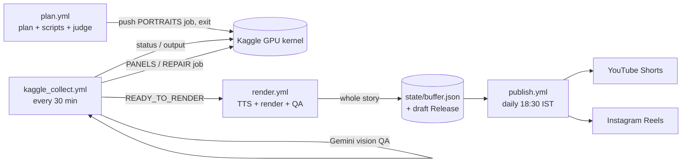

# Toonocalypse

A fully automated vertical motion-comic channel. Every day it publishes **one episode** of a 3–5 part story to YouTube Shorts and Instagram Reels. It runs at zero cost and needs no human work after setup.

- **GitHub Actions** handles orchestration, story writing (Gemini free tier), QA, voices (Kokoro), rendering (ffmpeg) and publishing.
- **Kaggle GPU notebooks** are the **only** image source (SDXL + IP-Adapter), generating art in story-sized batches.

Priorities: **quality > reliability > simplicity > cadence > features**. A weak episode is never published. Skipping a day is fine.

---

## How it works



1. **Plan** (`plan.yml`): pick a category (never the same twice in a row) or the next seed story. The planner writes the logline, moral, part count, 2–4 character **lock cards** and the beat sheet. Scripts for **all** parts are written up front. A separate **judge** scores them and must pass (average ≥ 8, hook ≥ 8, safety 10), with up to 3 rewrites. Otherwise the story is aborted.
2. **Art** (`kaggle_collect.yml`), a state machine `PORTRAITS → PANELS → REPAIR → READY_TO_RENDER`:
   - **Portraits:** 8 candidates per character, filtered in the kernel to the top 3. Gemini vision then checks each against the lock card. One repair round is allowed, then the story is aborted.
   - **Panels:** every panel of every part in **one** Kaggle session, 3 candidates each. Character-free shots skip IP-Adapter. Two-character panels use masked left/right IP-Adapter. The kernel pre-filters with a CLIP score, DINOv2 similarity to each portrait and an OCR text check, keeping the top 2.
   - **Panel QA:** Gemini vision scores each panel. Pass = every score ≥ 7, average ≥ 8, safety 10. Up to 2 repair rounds (new seeds, stronger IP-Adapter), then the story is aborted.
   - **No polling on GitHub:** a workflow pushes the job and exits. Collect runs exit in seconds when nothing is running.
   - **Resume:** if a session dies, whatever it saved is collected and only the missing items are re-pushed.
3. **Render** (`render.yml`): Kokoro voices with word timings drive the rest.
   - **Picture:** eased Ken Burns, flash + shake on action beats, code-drawn speech bubbles in the empty top area, word-highlighted captions, SFX words.
   - **Part-specific extras:** a "Previously…" banner on parts 2+. On the final part, a moral card and a loop match-cut back to the hook image.
   - **Sound and QA:** the mix is normalized to −14 LUFS. Render QA checks resolution, fps, the 45–60 s length, audio, loudness and black/frozen frames.
   - **Into the buffer:** a story enters `state/buffer.json` only when **every** part passes. Videos, covers, script and QA report go to a **draft** Release.
4. **Publish** (`publish.yml`): the oldest buffered story goes out, parts strictly in order, to both platforms. It is idempotent: `state/published.json` is checked, plus a hidden episode tag on YouTube and a caption match on Instagram. If one platform fails, the other still posts, and the failed one retries the same episode next run. An empty buffer means a successful no-op.

**Abort policy:**
- Expected stops (quality gates, quotas, auth) end green with `ABORTED: reason`. Real exceptions fail loudly.
- Three aborts in a row pause generation for 12 h.
- Kaggle GPU budget exhausted (85 % of the weekly quota) → generation pauses until the reset, while publishing continues from the buffer.
- Only one alert Issue (`toonocalypse-alert`) is ever open. It is updated in place and closed after the next success.

---

## One-time setup

### 1. Kaggle (art engine)
1. Create a Kaggle account and **verify your phone number**. GPU notebooks require it.
2. Go to Settings → API → **Create New Token**. Copy the `KGAT_…` token.
3. Repo secrets: `KAGGLE_USERNAME` (your Kaggle username) and `KAGGLE_API_TOKEN` (the `KGAT_…` token).
4. Nothing else. The first job push creates the private kernel `<username>/toonocalypse-art`, with GPU and internet on.

Quota: about **30 GPU-hours/week** (rolling) and **12 h max per session**. The system stops at 85 % (`config/models.yaml → kaggle`). One 3-part story costs roughly 1–1.5 GPU-h.

### 2. Gemini
`GOOGLE_API_KEY` is a free-tier key from Google AI Studio. Models are auto-discovered from `config/models.yaml → gemini`.

### 3. YouTube
1. Create a Google Cloud project, enable **YouTube Data API v3** (and **YouTube Analytics API** for the weekly report), and create an OAuth client of type **Desktop**.
2. Set the OAuth consent screen to **In production**. Tokens issued while it is in *Testing* expire after 7 days.
3. Get a refresh token with the scopes `youtube.upload`, `youtube`, and `yt-analytics.readonly` (optional).
4. Secrets: `YOUTUBE_CLIENT_ID`, `YOUTUBE_CLIENT_SECRET`, `YOUTUBE_REFRESH_TOKEN`.
5. **API audit:** uploads from unverified API projects may be forced to *private*. Submit the project for the YouTube API Services audit (Google Cloud Console → YouTube Data API → *Quotas & audit*). Until it's approved, keep `publish.youtube_privacy` as you prefer.

### 4. Instagram
1. You need an Instagram professional account linked to a Facebook Page, plus a Meta app with Instagram Graph API permissions (`instagram_content_publish`, `instagram_basic`).
2. Secrets: `IG_USER_ID` and `IG_ACCESS_TOKEN`. The token should be long-lived. A non-expiring Page-derived token is best.
3. `tokens.yml` refreshes Instagram-login (`IGAA…`) tokens weekly when fewer than 20 days remain and writes the new token back to the secret.
4. Facebook-login (`EAA…`) user tokens can't be refreshed without the app secret. The watchdog alerts before they expire.

### 5. GitHub
`GH_TOKEN` is a **fine-grained** PAT for this repo only, with *Secrets: read & write*. It's used only to write the refreshed Instagram token back. Everything else uses the built-in `GITHUB_TOKEN`.

The complete secret list is: `GOOGLE_API_KEY`, `YOUTUBE_CLIENT_ID`, `YOUTUBE_CLIENT_SECRET`, `YOUTUBE_REFRESH_TOKEN`, `IG_ACCESS_TOKEN`, `IG_USER_ID`, `GH_TOKEN`, `KAGGLE_USERNAME`, `KAGGLE_API_TOKEN`.

---

## Dry run (proof before going live)
1. **Actions → Plan Story → Run**, seed `The Golden Rickshaw`. This plans, scripts, judges and pushes the PORTRAITS job.
2. **Actions → Kaggle Collect → Run** (repeat until it reports `READY_TO_RENDER`). It collects, runs QA and pushes PANELS/REPAIR. `render.yml` then starts by itself.
3. Review the **draft Release** named after the story id: portraits, panels, `qa_report.json` (every QA score), and the 3 rendered parts with covers.
4. Kernel smoke test, which needs no scripts: **Kaggle Collect** with `command=smoke`, then `smoke-collect`. Outputs go to the `smoke-test` draft release.

### Going live
Once you approve the dry run, uncomment the `schedule:` blocks in `plan.yml` (every 6 h), `kaggle_collect.yml` (`*/30 * * * *`), `publish.yml`, `tokens.yml`, `watchdog.yml`, `report.yml` and `compile.yml`.

---

## Decisions & trade-offs (where the spec left room)
- **Job hand-off:** the job (prompts, seeds, references) is base64-embedded in the pushed kernel file, and approved portraits travel inside the job as small JPEGs. The kernel needs no repo clone, no dataset and no credentials.
- **Model weights:** the kernel downloads SDXL / IP-Adapter / CLIP / DINOv2 from Hugging Face at session start. That takes about 1–2 min inside Kaggle's network, versus about 60 min of GPU time per story. I did not build the "private Kaggle dataset" step: uploading about 8 GB through a GitHub runner is slow and fragile. It can be added later via `dataset_sources` if HF downloads become a problem.
- **Long prompts:** SDXL's CLIP limit is 77 tokens, so prompts are encoded with `compel` (no truncation). The lock-card `visual_prompt` is injected **verbatim** for every character in every panel.
- **Captions and bubbles:** dialogue appears in a speech bubble, and all speech also appears as word-highlighted captions for sound-off viewers. Narration has captions only. "Previously…" is shown, not spoken, to keep the hook fast.
- **Music:** if `assets/music/<mood>/` contains a licensed track (listed in `LICENSES.md`), it's used. Otherwise an **original synthesized pad** for that mood (dedicated to CC0) plays under the voices. Adding real CC0 or Pixabay tracks per mood (epic, mystery, emotional, tech) will improve the sound.
- **Piper fallback:** implemented as config but **disabled** (`tts.piper_voice: null`) until a voice with a commercial-safe dataset license is verified. If Kokoro fails, the story aborts rather than using an unverified voice.
- **`made_for_kids`** defaults to `false`. Setting it to `true` disables comments, notifications and personalized ads on YouTube and lowers revenue. With `false`, the content must stay ages 10+ general audience, which the judge and QA enforce.
- **Instagram cover:** Reels use the first frame (the hook image) as cover. The code-drawn cover is set as the YouTube thumbnail (best effort).

## Repo layout
```
.github/workflows/  plan, kaggle_collect, render, publish, compile, tokens, watchdog, report, ci
kaggle/             art_kernel.py, kernel-metadata.json.template, requirements.txt
src/                story/ kaggle_jobs/ qa/ audio/ render/ publish/ tokens/ analytics/ common/
config/             settings.yaml, models.yaml, categories.yaml, style_guide.md
state/              story_bible.json, buffer.json, published.json, quota.json, tokens.json
assets/             fonts/, music/
```
All model names, thresholds, times and weights live in `config/`. See `LICENSES.md` for every model, voice, font and music license.
